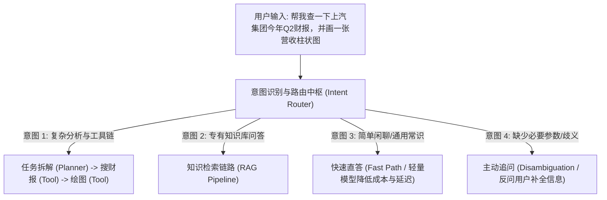
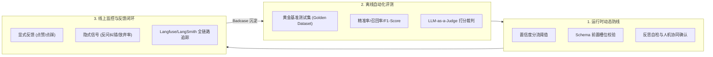

# AI Agent 意图识别与评测体系全景指南

> 本文系统梳理了 AI Agent 体系中的**意图识别（Intent Recognition）**概念、核心作用、主流工程实现方案，以及在研发与生产中如何判断意图识别是否正确、是否达到用户预期的完整闭环方案。

---

## 目录

- [一、 什么是 AI Agent 中的“意图识别”？](#一-什么是-ai-agent-中的意图识别)
  - [1.1 核心定义](#11-核心定义)
  - [1.2 传统 NLP vs 现代 AI Agent 意图识别演进](#12-传统-nlp-vs-现代-ai-agent-意图识别演进)
- [二、 意图识别在 Agent 工作流中的核心价值](#二-意图识别在-agent-工作流中的核心价值)
  - [2.1 任务拓扑流程](#21-任务拓扑流程)
  - [2.2 4 大关键能力](#22-4-大关键能力)
- [三、 3 种主流工程实现方案](#三-3-种主流工程实现方案)
  - [方案 1：基于 LLM 结构化输出（Structured Output / Function Calling）](#方案-1基于-llm-结构化输出structured-output--function-calling推荐主流)
  - [方案 2：向量语义路由（Semantic Router）](#方案-2向量语义路由semantic-router极低延迟与零-token-成本)
  - [方案 3：多智能体主管路由（Multi-Agent Supervisor）](#方案-3多智能体主管路由multi-agent-supervisor)
- [四、 如何判断意图识别是否符合预期（正确性判定与评测）](#四-如何判断意图识别是否符合预期正确性判定与评测)
  - [4.1 运行时动态校验（Runtime Guardrails）](#41-运行时动态校验runtime-guardrails)
  - [4.2 离线基准评测（Offline Evaluation）](#42-离线基准评测offline-evaluation)
  - [4.3 线上生产观测与用户反馈闭环（Production Observability）](#43-线上生产观测与用户反馈闭环production-observability)
- [五、 架构落地最佳实践与避坑指南](#五-架构落地最佳实践与避坑指南)

---

## 一、 什么是 AI Agent 中的“意图识别”？

### 1.1 核心定义

在 AI Agent 架构中，**意图识别（Intent Recognition / Intent Classification）** 是整个系统的 **“前置路由器（Router / Dispatcher）” 与 “决策分发中枢”**。

它指的是：**从用户的非结构化自然语言输入中，结合历史对话上下文，精准解析出用户「真正想完成的目标（What）」以及「执行该目标所需的关键参数与实体（With What）」，从而决定下一步激活哪一个子 Agent、调用哪类外部工具，或进入哪条特定业务流水线。**

### 1.2 传统 NLP vs 现代 AI Agent 意图识别演进

| 维度 | 传统 NLP / 客服机器人 (如 Rasa, Dialogflow) | 现代 AI Agent 系统 (如 LangChain, LangGraph) |
| :--- | :--- | :--- |
| **底层驱动** | 正则规则、SVM、轻量分类模型 (BERT) | 大语言模型 (LLM)、Few-Shot Prompting、语义向量路由 |
| **意图分类** | 严格受限于预设的固定分类标签 | 开放域意图理解、复合多意图推导、动态任务解构 |
| **后续响应** | 触发固定问答库或预定义的状态机脚本 | **规划与行动（Planning & Action）**：动态调用工具、分发给专家 Sub-Agent |
| **实体提取** | 机械的实体命名抽取（NER）与逐项填槽 | 上下文感知的结构化推导，具备语义联想与缺损参数追问机制 |

---

## 二、 意图识别在 Agent 工作流中的核心价值

### 2.1 任务拓扑流程



### 2.2 4 大关键能力

1. **动态路由分发（Dynamic Routing）**：
   * 识别用户是寻求知识库检索（RAG）、API 工具调用（Tool Execution）、复杂多步规划（ReAct Agent），还是通用对话。
2. **快慢路径分流（Fast Path vs. Slow Path，降本增效）**：
   * **快路径（Fast Path）**：简单提问分配给低延迟、低成本小模型（如 GPT-4o-mini、Gemini Flash），200ms 内直出。
   * **慢路径（Slow Path）**：深度推理或复杂业务，分流给具备强化推理能力的模型或多 Agent 协作系统。
3. **参数抽取与校验（Slot Filling & Schema Extraction）**：
   * 将模糊文本转化为下游工具可消费的类型安全参数（例如时间、金额、查询过滤条件）。
4. **安全护栏与拦截（Security Guardrails）**：
   * 识别 Prompt 注入、越狱、违规或越权操作，并在最前置节点快速拦截。

---

## 三、 3 种主流工程实现方案

### 方案 1：基于 LLM 结构化输出（Structured Output / Function Calling）【推荐主流】

通过引入严格的 Schema 定义（如 TypeScript 中的 `Zod` 或 Python 中的 `Pydantic`），约束轻量级 LLM 输出类型安全的 JSON 意图对象。

```typescript
import { z } from "zod";

// 定义意图协议结构
export const IntentSchema = z.object({
  // 核心意图大类
  category: z.enum([
    "KNOWLEDGE_SEARCH", // 知识库检索 (走 RAG)
    "TOOL_EXECUTION",    // 工具执行 (查天气、执行计算、查接口)
    "TASK_PLANNING",     // 复杂多步骤任务拆解
    "CHIT_CHAT",         // 闲聊 / 常识问答
    "UNCLEAR"            // 意图模糊，需澄清
  ]).describe("用户的核心意图类别"),
  
  // 意图置信度 (0 ~ 1)
  confidence: z.number().min(0).max(1).describe("模型对当前分类的置信度评分"),
  
  // 提取出的强类型参数槽位
  extractedParams: z.record(z.any()).describe("提取出的核心参数，例如实体名称、时间范围、查询过滤项"),
  
  // 追问话术（当意图不明确或缺少必要参数时使用）
  clarificationPrompt: z.string().optional().describe("当 category 为 UNCLEAR 或缺少关键参数时，用于向用户反问的话术")
});

export type UserIntent = z.infer<typeof IntentSchema>;
```

### 方案 2：向量语义路由（Semantic Router）【极低延迟与零 Token 成本】

对于意图边界明确的固定场景（如企业客服、工单分类）：
- 将不同意图的代表性例句预先向量化（Embedding）。
- 用户提问时，计算输入与各意图向量的余弦相似度（Cosine Similarity）。
- **优势**：响应通常在 **5 ~ 20ms** 之间，不消耗 LLM 推理 Token，极大降低服务器开销。

### 方案 3：多智能体主管路由（Multi-Agent Supervisor）

在复杂 Agent 系统（如基于 LangGraph 构建）中，Supervisor Agent 作为总控中心：
- 每一轮对话评估当前任务进展与用户最新指令。
- 动态把控制权交接（Handoff）给对应的垂直专家 Agent（如 CodeAgent、SearchAgent、DataAnalysisAgent）。

---

## 四、 如何判断意图识别是否符合预期（正确性判定与评测）

评估意图识别是否“准确”、是否“达成用户预期”，需从**运行时、离线评测、线上闭环**三维建立立体保障体系：



### 4.1 运行时动态校验（Runtime Guardrails）

Agent 在真正执行 Action 之前，进行自检与防御：

1. **置信度阈值阶梯（Confidence Thresholding）**：
   * **高置信度（> 0.85）**：直接静默调用下游链路。
   * **中置信度（0.50 ~ 0.85）**：**主动回显并向用户确认**（例如：“我理解您可能希望【导出上月合同报表】，请问是否立即执行？”）。
   * **低置信度（< 0.50）**：触发降级兜底（Fallback），引导用户换种方式提问。
2. **前置槽位与类型校验（Slot Validation）**：
   * 即使识别到了操作意图，若缺少关键必填参数（如“请帮我转账”，缺少收款方和金额），判定为“意图不完备”，立即转入追问交互。
3. **关键/破坏性操作的人机协同（Human-in-the-Loop）**：
   * 涉及写库、删除、转账、发送敏感邮件的操作，强制增加用户二次确认机制。
4. **反思自检（Self-Reflection / Critic）**：
   * 在关键业务节点，使用轻量 Critic Prompt 对意图进行第二意见（Second Opinion）复核。

### 4.2 离线基准评测（Offline Evaluation）

系统上线或 Prompt 迭代前，使用自动化评测规避回归问题：

1. **构建黄金测试集（Golden Dataset）**：
   * 维护包含 200~1000 条样本的基准集，覆盖：**标准意图样本**、**边界模糊样本**、**复合多意图样本**以及**恶意攻击/噪音样本**。
2. **量化统计指标**：
   * **精准率（Precision）**：识别为某意图的样本中，真正属于该意图的比例（防误触发）。
   * **召回率（Recall）**：属于某意图的所有样本中，被系统正确识别出的比例（防漏识别）。
   * **混淆矩阵（Confusion Matrix）**：定位哪两个意图类别之间最容易产生混淆。
3. **LLM-as-a-Judge 自动化裁判**：
   * 针对主观性较强的开放式意图，由性能更强的顶尖模型（如 Claude 3.7 Sonnet / GPT-4o）作为裁判模型打分并输出判定依据。

### 4.3 线上生产观测与用户反馈闭环（Production Observability）

系统上线后，持续从真实用户行为中捕获意图偏离信号：

1. **用户行为隐式负反馈（Implicit Signals）**：
   * **用户纠错/打断行为**：用户下一轮消息包含“不是”、“理解错了”、“不对”、“我是说...”等特征词，系统可自动将上一轮意图标记为 `Misclassified`。
   * **快速流失率（Drop-off Rate）**：用户提问后直接跳出离开，通常暗示回复未切中痛点。
   * **工具报错率（Tool Execution Errors）**：意图派发了特定工具，但接口高频抛出参数校验异常，说明参数抽取或意图存在偏差。
2. **显式反馈（Explicit Feedback）**：
   * 提供“点赞 / 点踩”按钮，点踩时收集具体原因（如“答非所问”、“没有执行我的指令”）。
3. **可观测性链路追踪（Tracing）**：
   * 接入 **Langfuse** 或 **LangSmith** 等工具，端到端捕获 `Input -> Intent -> Route -> Tool -> Output -> User Feedback` 链路，形成 Badcase 样本池持续充实 Few-shot 样例。

---

## 五、 架构落地最佳实践与避坑指南

1. **原则：宁可礼貌追问，绝不盲目瞎猜**：
   * 意图不明确时，主动向用户澄清反问的体验，远比“一本正经地胡说八道”或调用错误接口要好得多。
2. **渐进式演化路径**：
   * **第一阶段（冷启动）**：使用 `Zod Schema + Structured Output` 保证接口契约稳定。
   * **第二阶段（高并发与降本）**：将高频固定意图抽取为 `Semantic Router` 向量路由，毫秒级分流。
   * **第三阶段（持续迭代）**：建立 `Langfuse Tracing` 捕获线上 Badcase，扩充到 Few-shot Prompt 或微调（Fine-Tuning）轻量分类模型中。
